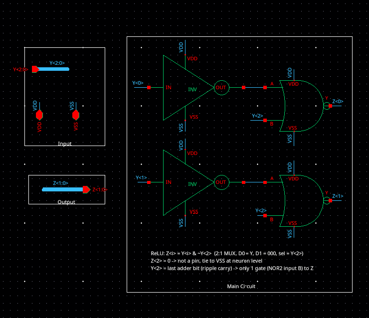
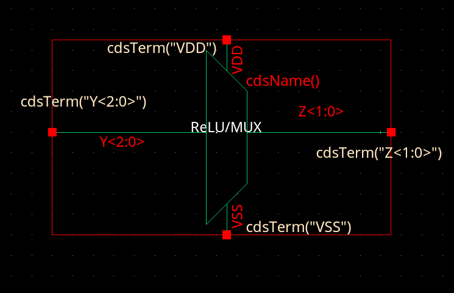
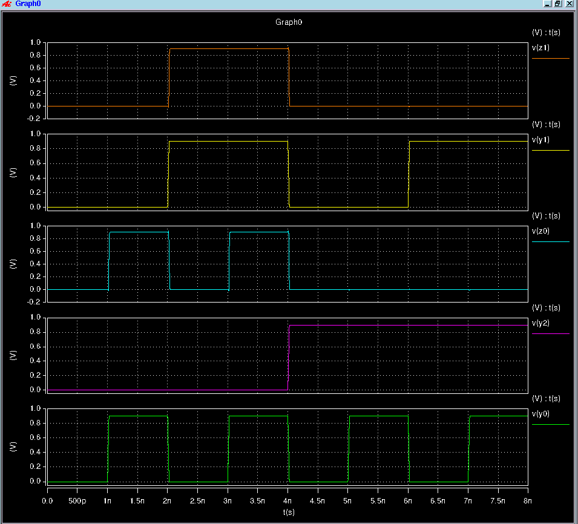
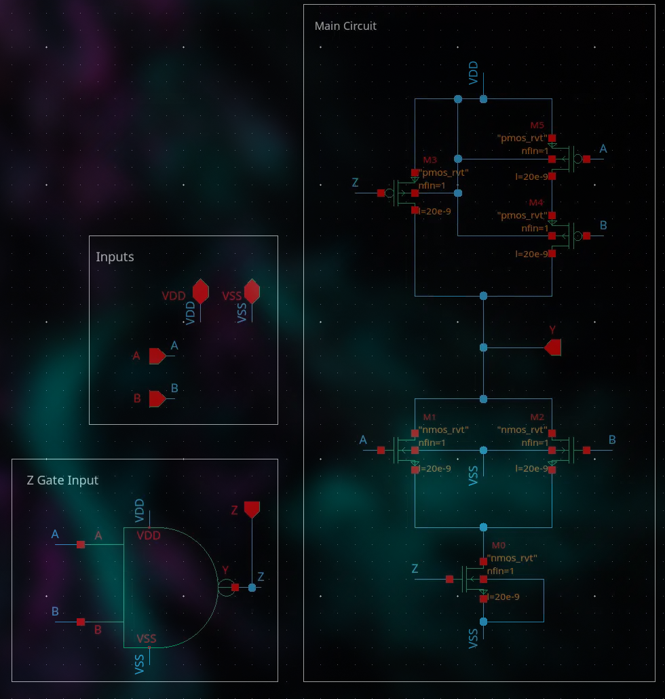

# 555_project
(FYI - using claude to organize the readme better)

Blocks needed: multiplier, 2-bit adder, 3-bit adder, 3-bit 2-to-1 MUX (ReLU), combined into a neuron

All schematics: [docs/project_schematics.pdf](docs/project_schematics.pdf)

## Progress

**XNOR Z** (`XNOR_Z`) (Same as the XNOR, but added the NAND AB as an output (can use instead of computing NAND again))
- [x] Schematic
- [x] Symbol
- [x] Tested (correct output)
- [ ] Beta matching (NMOS/PMOS sizing)

**Half adder** (`Half_adder`): used for bit 0 (no carry-in)
- [x] Schematic
- [x] Symbol
- [ ] Tested

**Full adder** (`Full_adder`): used for bits 1 and up
- [x] Schematic
- [x] Symbol
- [ ] Tested

**2-bit adder** (`2bit_adder`): ripple carry, **signed** (2's complement), inputs limited to -1, 0, 1 (`10` never occurs), 3-bit sign-extended output `S<2:0>`
- [x] Schematic (updated for signed addition, see [2-bit signed adder](#2-bit-signed-adder))
- [x] Symbol
- [ ] Tested

**3-bit adder** (`3bit_adder`): ripple carry, signed. In the neuron, only `S<2:0>` is used (`S<3>` is unconnected)
- [x] Schematic
- [x] Symbol
- [ ] Tested

**Multiplier** (`Multiplier`, 2-bit signed, inputs -1, 0, 1)
- [x] Schematic
- [x] Symbol
- [x] Tested (all 9 input combos, FO4 load)

**3-bit 2-to-1 MUX / ReLU** (`MUX3_RELU`): D0 = adder sum `Y<2:0>`, D1 = `000`, select = sign bit `Y<2>`
- [x] Schematic
- [x] Symbol
- [x] Tested (exhaustive, 8 input cases, FO4 load, 0.9 V, 25 ps edges: all pass)
- [x] Beta matching (reuses `INV_fin_larger` 2n/3p and `NOR2` 2n/6p, beta 1.5)

Reuses `INV_fin_larger` and `NOR2` (no new supporting cells).

**Neuron**: 2 multipliers -> 2-bit adder -> 3-bit adder (+ bias) -> ReLU (`MUX3_RELU`)
- [x] Schematic
- [ ] Symbol
- [ ] Tested

Supporting cells already in the library: `INV_fin_larger`, `NAND2`, `NOR2`, `AND2`,
(INV_fin_larger is a 1.5 beta inverter while INV is a 1 beta (could remove gates if not needed like INV and AND2))
(Might want to check to make sure my NAND AND INV is good with everyone)

## Adder design

Decided on a **ripple-carry adder** for least amount of transistors used (also dont really need CLA for 2/3bits):

- **Bit 0** uses a **half adder**, since there's no carry-in for the first bit.
- **Bits 1 and up** use **full adders**, each taking the carry-out from the previous bit.
- `2bit_adder` = half adder + 1 full adder + sign-extension logic for `S<2>` (signed, full adder `Cout` unused)
- `3bit_adder` = half adder + 2 full adders

## Boolean logic

Paste the expressions into https://www.boolean-algebra.com/ to check them. Notation: `'` = NOT, `+` = OR, `AB` = A AND B.

### XNOR / XNOR_Z

Desired Logic: AB + A'B'


```
CMOS implementation: Y = (A + B (AB)')'

Z  = (AB)'                     NAND2 in the "Z Gate Input" box (XNOR_Z also outputs this)

Y  = ((A + B)Z)'
   = Z' + A'B'
   = AB + A'B'                 substitute Z' = AB
   = A XNOR B
```

| A | B | Z = (AB)' | Y = A XNOR B |
|:-:|:-:|:-:|:-:|
| 0 | 0 | 1 | 1 |
| 0 | 1 | 1 | 0 |
| 1 | 0 | 1 | 0 |
| 1 | 1 | 0 | 1 |

### Half adder

Desired Logic: Sum = A^B | Cout = AB

```
X    = (A XNOR B) = AB + A'B'     XNOR_Z output Y
Z    = (AB)'                      XNOR_Z output Z
Sum  = X'  = A'B + AB'  = A XOR B
Cout = Z'  = AB
```

| A | B | X (XNOR) | Z (NAND) | Sum | Cout |
|:-:|:-:|:-:|:-:|:-:|:-:|
| 0 | 0 | 1 | 1 | 0 | 0 |
| 0 | 1 | 0 | 1 | 1 | 0 |
| 1 | 0 | 0 | 1 | 1 | 0 |
| 1 | 1 | 1 | 0 | 0 | 1 |

### Full adder

Desired: Sum = A^B^C | Cout = AB+C(A+B)

```


X1   = A XNOR B = (A XOR B)'      XNOR_Z(A, B), also gives Z = (AB)'
Sum  = X1 XNOR Cin                2 XNORs make an XOR, no inverter needed
     = A XOR B XOR Cin
P    = X1' = A XOR B              inverter
N1   = (P Cin)'                   NAND2
Cout = (Z N1)'                    NAND2
     = AB + P Cin
     = AB + (A XOR B)Cin
     = AB + ACin + BCin           majority function
```

| A | B | Cin | X1 | P | Z | N1 | Sum | Cout |
|:-:|:-:|:-:|:-:|:-:|:-:|:-:|:-:|:-:|
| 0 | 0 | 0 | 1 | 0 | 1 | 1 | 0 | 0 |
| 0 | 0 | 1 | 1 | 0 | 1 | 1 | 1 | 0 |
| 0 | 1 | 0 | 0 | 1 | 1 | 1 | 1 | 0 |
| 0 | 1 | 1 | 0 | 1 | 1 | 0 | 0 | 1 |
| 1 | 0 | 0 | 0 | 1 | 1 | 1 | 1 | 0 |
| 1 | 0 | 1 | 0 | 1 | 1 | 0 | 0 | 1 |
| 1 | 1 | 0 | 1 | 0 | 0 | 1 | 0 | 1 |
| 1 | 1 | 1 | 1 | 0 | 0 | 1 | 1 | 1 |

### 2-bit signed adder

**Fix:** the first version of `2bit_adder` did **unsigned** addition: `S<2>` was the full adder's `Cout`. The inputs are 2-bit 2's complement, limited to -1, 0, 1 (`10` = -2 never occurs). The sum (-2 to 2) needs a sign-extended 3rd bit. The fix leaves the full adder's `Cout` unconnected (noConn) and drives `S<2>` from a separate **Signed Extension Logic** box instead:

```
S<1:0>  = half adder + full adder (same as before)
N       = (A1 + B1)'                NOR2(A<1>, B<1>)
S<2>    = (S1' + N)'                NOR2(INV(S<1>), N)
        = S1 (A1 + B1)
```

Why it works: with inputs limited to -1 to 1, the sum is only negative when S1 = 1 and at least one input is negative (A1 or B1 = 1). The one other case with S1 = 1 is 1 + 1 = 2 (`010`), where A1 = B1 = 0, so S2 = 0.

| A | B | A + B | S<2:0> |
|:-:|:-:|:-:|:-:|
| 00 (0) | 00 (0) | 0 | 000 |
| 00 (0) | 01 (1) | 1 | 001 |
| 01 (1) | 01 (1) | 2 | 010 |
| 00 (0) | 11 (-1) | -1 | 111 |
| 01 (1) | 11 (-1) | 0 | 000 |
| 11 (-1) | 11 (-1) | -2 | 110 |

(A and B are symmetric, so swapped rows are omitted.)

Note: this logic is **only valid because `10` (-2) is never an input**. For -2 + -2 it outputs `000` instead of `100`. If the full -2 to 1 range is ever needed, use `S<2> = MAJ(A<1>, B<1>, S<1>)` instead.

### Multiplier

Inputs are 2-bit signed, limited to -1, 0, 1 (`10` never occurs), so the product is also -1, 0, 1 and fits in 2 bits:

- Bit 0 says whether the value is nonzero: the product is nonzero only if both inputs are, so `P<0> = A0 B0`.
- Bit 1 is the sign: the product is negative only if it's nonzero and the signs differ, so `P<1> = A0 B0 (A1 XOR B1)`.

```
n0   = (A0 B0)'                 NAND2
P<0> = n0' = A0 B0              INV
xn   = A1 XNOR B1               XNOR (Z output unused)
P<1> = (n0 + xn)'               NOR2
     = A0 B0 (A1 XOR B1)
```

| A | B | A x B | P<1:0> |
|:-:|:-:|:-:|:-:|
| 00 (0) | any | 0 | 00 |
| 01 (1) | 01 (1) | 1 | 01 |
| 01 (1) | 11 (-1) | -1 | 11 |
| 11 (-1) | 11 (-1) | 1 | 01 |

### 3-bit 2-to-1 MUX (ReLU)

Desired: z = max(0, y), y = `3bit_adder` output `S<2:0>` (two's complement, range -3..+3)

```
MUX:   Z<i> = S'·D0<i> + S·D1<i>      S = Y<2> (sign bit), D0 = Y, D1 = 000
     = Y<i>·Y<2>'                     D1 = 0 removes the second term
     = (Y<i>' + Y<2>)'                NOR2(A = INV(Y<i>), B = Y<2>)
Z<2> = Y<2>·Y<2>' = 0                 constant, no transistors (tie to VSS at top level)
```

| Y<2:0> | y | Z<1:0> | z |
|:-:|:-:|:-:|:-:|
| 000 | 0 | 00 | 0 |
| 001 | +1 | 01 | 1 |
| 010 | +2 | 10 | 2 |
| 011 | +3 | 11 | 3 |
| 100 | -4 (unused) | 00 | 0 |
| 101 | -3 | 00 | 0 |
| 110 | -2 | 00 | 0 |
| 111 | -1 | 00 | 0 |

- `Y<2>` is the slowest adder output (end of the ripple carry chain), so it goes straight into the NOR2: **1 gate** from sign bit to output.
  An AND2-based MUX (`AND2(Y<i>, INV(Y<2>))`) would put INV + NAND2 + INV = 3 gates on the critical path.
- `Y<2>` goes to NOR2 input `B`, whose PMOS is next to the output `Y` (late input near output).
- Both gates are shared cells: `INV_fin_larger` (2n/3p) and `NOR2` (2n parallel, 6p series each).
- Load on the adder: `Y<2>` drives 2 NOR2 inputs (2 x 8 fins); `Y<0>`, `Y<1>` drive 1 inverter each (5 fins).

Exhaustive test (`MUX3_RELU/tb_mux_func.sp`, FO4 load on each output, VDD = 0.9 V, 25 ps edges), sampled at 80% of each 1 ns state:

| Y<2:0> | Z1 (V) | Z0 (V) | Result |
|:-:|:-:|:-:|:-:|
| 000 | 4.4e-7 | 4.4e-7 | pass |
| 001 | 4.4e-7 | 0.900 | pass |
| 010 | 0.900 | 1.1e-5 | pass |
| 011 | 0.900 | 0.900 | pass |
| 100 | 4.4e-6 | 4.4e-6 | pass |
| 101 | 1.9e-6 | 4.6e-7 | pass |
| 110 | 4.6e-7 | 4.3e-6 | pass |
| 111 | 4.6e-7 | 4.6e-7 | pass |







### Neuron

```
y = X0 W00 + X1 W10 + W20
z = max(0, y)
```

- 2 `Multiplier`s: `X0 x W00` and `X1 x W10` (2-bit each)
- `2bit_adder` adds the two products -> `S<2:0>` (-2 to 2)
- `3bit_adder` adds the bias `W20<2:0>` -> `Y<2:0>`. `S<3>` is left unconnected, so the result is the 3-bit 2's complement sum
- `MUX3_RELU` -> `Z<1:0>`; `Z<2>` is tied to VSS through a `cds_thru` (Disconnect / Tie to ground box)

Note: since `S<3>` is dropped, the result is only correct if `y` stays within -4 to 3. With products summing to -2..2, that depends on the bias range of `W20`.

## Optimization approach

My goal was to use **as few transistors as possible**. Later we can decide whether to trade some transistors for fewer gates or a shorter critical path.


*`XNOR_Z` schematic: 6 transistors in the main circuit (M0 to M5) + a `NAND2` (4) in the Z Gate Input box = 10 transistors. It also shows the box layout described under Schematic conventions.*

### Transistor counts

| Cell | Built from | Transistors |
|---|---|---|
| `NAND2` | - | 4 |
| `INV` / `INV_fin_larger` | - | 2 |
| `XNOR` / `XNOR_Z` | 1 NAND2 (4) + 6 transistors | 10 |
| `Half_adder` | 1 XNOR_Z + 2 INV | 14 |
| `Full_adder` | 2 XNOR + 2 NAND2 + 1 INV | 30 |
| `NOR2` | - | 4 |
| `2bit_adder` | 1 Half_adder + 1 Full_adder + 1 INV + 2 NOR2 (sign ext.) | 54 |
| `3bit_adder` | 1 Half_adder + 2 Full_adder | 74 |
| `Multiplier` | 1 NAND2 + 1 INV + 1 XNOR + 1 NOR2 | 20 |
| `MUX3_RELU` | 2 INV_fin_larger + 2 NOR2 | 12 |
| `Neuron` | 2 Multiplier + 2bit_adder + 3bit_adder + MUX3_RELU | 180 |

- **Half adder:** Sum = INV(XNOR(A, B)). Carry = INV(Z), where Z is the NAND(A, B) output already inside `XNOR_Z`, so carry needs no extra NAND.
- **Full adder:** two XNORs chained give the sum (no inverter needed). The carry uses NANDs, and the critical path is 4 gates: XNOR, INV, NAND, NAND.

## Schematic conventions

Each schematic is split into boxes drawn with notes:

- **Inputs box:** input pins, plus VDD/VSS
- **Outputs box:** output pins, if needed
- **Main circuit box:** the core logic
- **Sub-circuit box(es):** helper pieces, such as the NAND inside the XNOR

Guidelines (If you guys want to change these let me know - just how I do it):

1. Use the same layout in every cell so anyone opening it knows where to look.
2. Connect between boxes with wire labels instead of long wires. Double-check label spelling, because a typo creates a floating net.
3. The boxes are only drawings. Under Notes (can do a label and a shape)
4. Write design notes in the boxes (critical path, beta ratios, why a gate is reused) (I need to do this in my schematic still).

Example:



Only need an output box if you have a wire bus with a bunch of wire connecting into the output.

For symbol, have VDD top, VSS bottom, Inputs left, Outputs right if it makes sense, in the 2/3bit adder I had the S pin be on the bottom.
